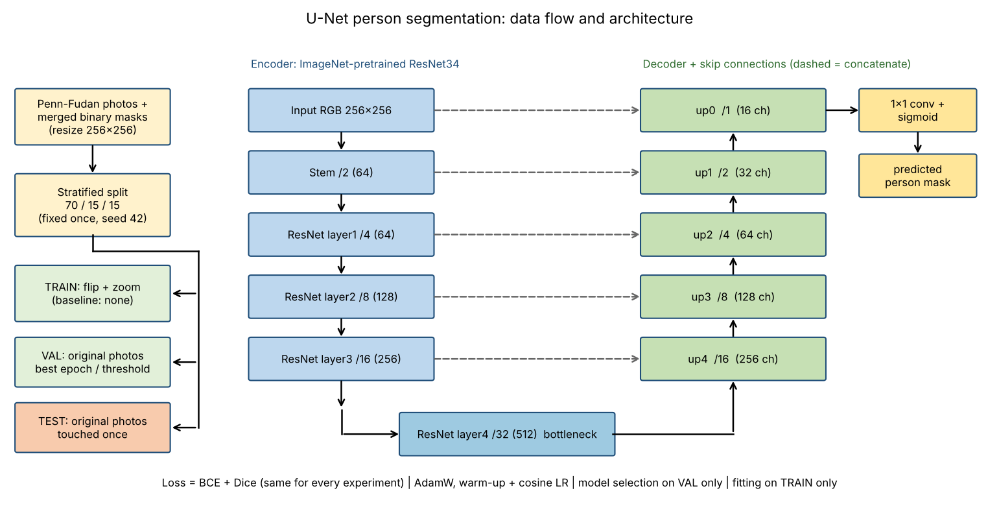
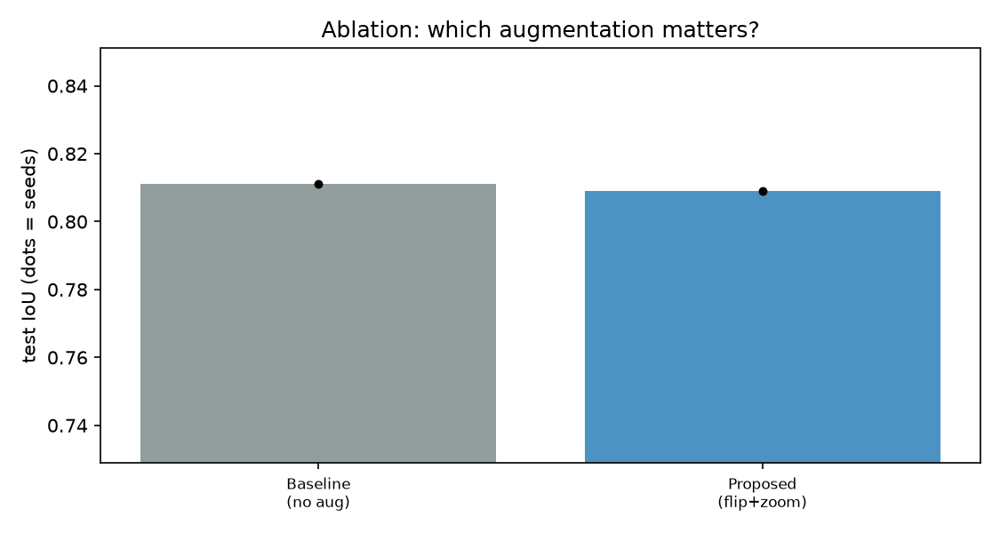
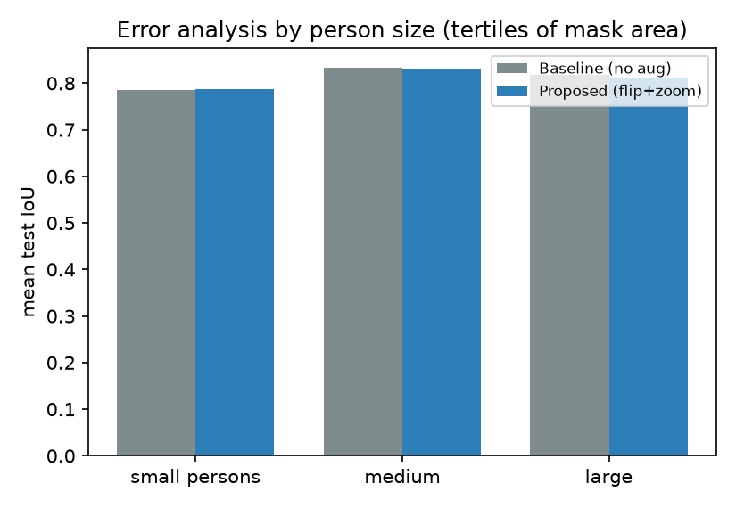
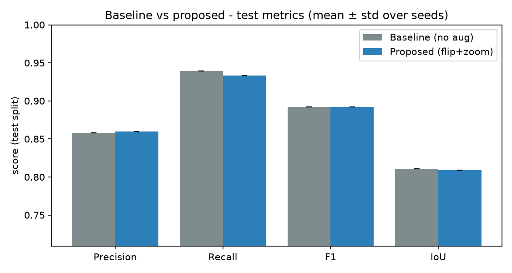
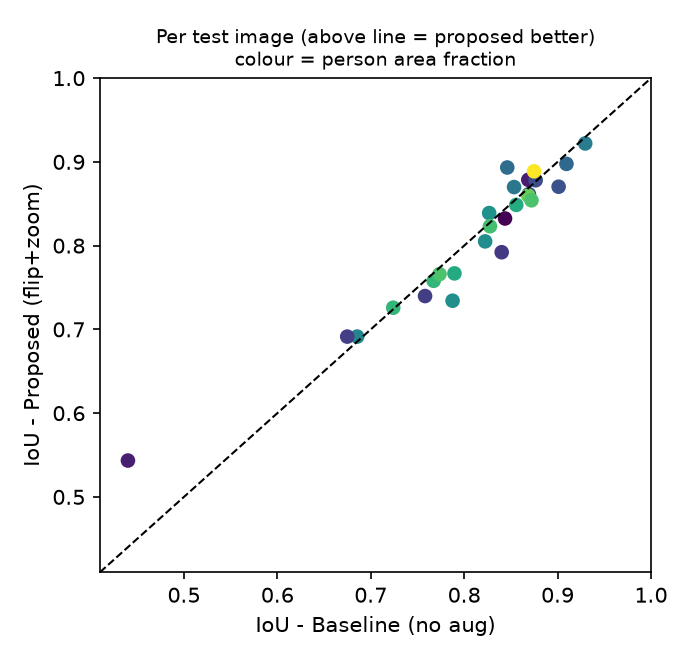
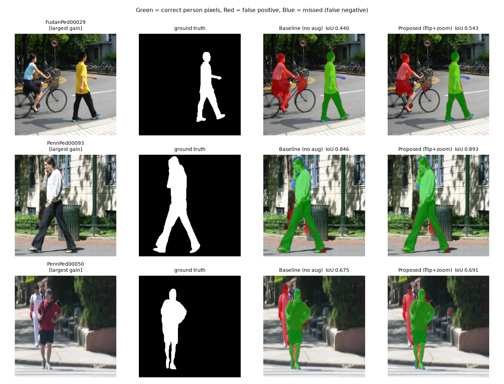
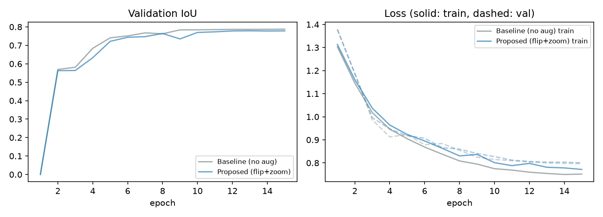

# Effect of Flip and Zoom Augmentation on U-Net Person Segmentation in Penn-Fudan Images

**Task:** binary person segmentation (person vs. background) on the Penn-Fudan Pedestrian set, 256 × 256 inputs,
U-Net architecture, IIT Patna ML project (*Image Segmentation → Problem 4*).
**Hypothesis (stated before running):** training the *same* U-Net with horizontal flip + small zoom improves
test precision / recall / F1 / IoU over the same U-Net trained on the unchanged photographs, because the
dataset is tiny (170 photos) and people appear at different sizes and facing either way.

> **Honest status note.** I wrote this project in a sandbox with no GPU, no access to the Penn-Fudan download and no working
> PyTorch install. The data loading, mask merging, stratified split, augmentation, metrics and synthetic-data generator were run and
> checked there, but **the PyTorch parts (model, training, evaluation, plots) have not been executed by me**, and **no IoU number
> exists yet**. Run `bash scripts/run_smoke.sh` first (unit tests + the whole pipeline on synthetic data, minutes on CPU); if anything
> fails, send me the traceback and I will fix it. The results section below is filled **automatically** from your real run - nothing in it
> is typed by hand. If augmentation does *not* help in your run, the tables will say so; report that honestly.

---

## 1. What is in this project (and what I added beyond the brief)

| # | Item | Required by brief? | Why |
|---|------|--------------------|-----|
| 1 | U-Net, binary person mask, merged instances, 256×256 | **yes** | core task |
| 2 | Baseline = same U-Net, **no augmentation**; Proposed = same U-Net + **horizontal flip + small zoom (×0.8-1.2)**; same loss, split, seeds, optimiser | **yes** | core comparison |
| 3 | Test on the original (un-augmented) photographs; Precision, Recall, F1, IoU | **yes** | core metrics |
| 4 | **ResNet34-encoder U-Net** (ImageNet-pretrained) with skip connections at every level | *addition* | 119 training images cannot train a 30 M-parameter U-Net from scratch well; a pretrained encoder is the single biggest IoU lever. It is still a U-Net (expanding path + skip concatenations). A from-scratch `vanilla_unet` is included (`model.arch=vanilla_unet`). |
| 5 | **Full-resolution RGB skip** into the last decoder block | *addition* | sharper outlines than stopping at ½ resolution |
| 6 | **Compound BCE + soft-Dice loss** (same for both models) | *addition* | per-pixel term + overlap term; directly aligned with IoU/F1 |
| 7 | **Ablation**: flip-only, zoom-only | *addition* (brief asks for the "change removed" comparison) | shows *which* augmentation helps |
| 8 | **3 seeds, mean ± std** | *addition* | guidelines: "do not report a single favourable run" |
| 9 | **Paired statistics** on identical test images: Δ IoU, bootstrap 95 % CI, Wilcoxon test, seeds-won | *addition* | with only ~26 test images, differences can be noise - this quantifies it |
| 10 | **Stratified split** by image source (Penn / Fudan) × person-size tertile | *addition* | train/val/test see the same mix of scenes and person sizes |
| 11 | **Boundary-F1** (2-px tolerance) | *addition* | IoU hides outline quality; this measures it |
| 12 | **Error analysis**: IoU by person size, per-image scatter, gallery of biggest gains and worst cases with TP/FP/FN colouring | *addition* | guideline Step 11 |
| 13 | **`proposed_plus`** = flip + zoom + rotation + shift + colour jitter | *addition, reported separately* | tries to push IoU higher; never mixed into the required comparison |
| 14 | **Flip test-time augmentation** and **validation-tuned threshold** (reported as extra rows) | *addition* | free IoU; threshold is chosen on validation only, never on test |
| 15 | Dataset audit/EDA, experiment log CSV, environment dump, saved split, unit tests, auto-generated results | *addition* | reproducibility guidelines |

**Rule followed everywhere:** the test split is touched once per trained model, after model selection on validation.
Normalisation uses fixed ImageNet constants (nothing is fitted on any split). Model selection (best epoch, early stopping, threshold) uses validation only.

## 2. Method



*Architecture. Training uses augmented training images only; validation selects the best epoch; the held-out test set
(original photographs) is used only for the final evaluation.*

**Algorithm - Person-Segmentation-U-Net with Augmentation Study**

```
Input : Penn-Fudan images I_k with instance masks M_k, augmentation settings A in {none, flip+zoom, ...}, seeds S
Output: fitted U-Nets f_A, test metrics (Precision, Recall, F1, IoU)
1.  For every image: y_k <- [M_k > 0]            (merge all people into one foreground class)
2.  Resize I_k and y_k to 256x256 (area interpolation for I_k, area + 0.5-threshold for y_k)
3.  Split once (seed 42) into D_train / D_val / D_test, stratified by source x person size
4.  For each augmentation setting A and each seed s in S:
5.      Initialise U-Net (ImageNet ResNet34 encoder + random decoder) with seed s
6.      For epoch = 1..E:
7.          for each mini-batch of D_train: apply A jointly to image and mask; minimise L = BCE + Dice (AdamW, warm-up + cosine LR)
8.          compute IoU on D_val (un-augmented); keep the checkpoint with the best val IoU; stop early after `patience` epochs
9.      Load the best checkpoint; predict D_test (original, un-augmented photographs); report P, R, F1, IoU, Boundary-F1
10. Compare A=none vs A=flip+zoom on identical test images (mean ± std over seeds, paired bootstrap, Wilcoxon)
```

**Loss (identical for every experiment):**
`L = BCE(p, y) + (1 − (2·Σ p·y + 1) / (Σ p + Σ y + 1))`, the Dice term computed per image and averaged.

**Metrics** (per test image, then averaged; pooled-pixel IoU is also reported):
Precision = TP/(TP+FP), Recall = TP/(TP+FN), F1 = 2TP/(2TP+FP+FN), IoU = TP/(TP+FP+FN).

## 3. Installation

Requires Python ≥ 3.9. A GPU is strongly recommended (CPU works but is slow); Google Colab (free T4) is enough.

```bash
# 1. get the project
unzip person_seg_unet.zip && cd person_seg_unet

# 2. create an environment
python -m venv .venv
source .venv/bin/activate            # Windows: .venv\Scripts\activate

# 3. install dependencies (for GPU, first install the matching CUDA build of torch from pytorch.org)
pip install -r requirements.txt

# 4. download the dataset (~50 MB) into data/PennFudanPed
python -m src.download_data
#    if the download fails, get PennFudanPed.zip from
#    https://www.cis.upenn.edu/~jshi/ped_html/PennFudanPed.zip and unzip into data/  ->  data/PennFudanPed/{PNGImages,PedMasks}
```

## 4. Running

```bash
# (optional) sanity check on synthetic data: unit tests + the whole pipeline in a few minutes, CPU is fine
bash scripts/run_smoke.sh

# dataset audit + EDA figures  ->  results/audit_summary.json, results/figures/eda_*.png
python -m src.eda

# the full study: 5 experiments x 3 seeds (train + test + tables + figures + README update)
python -m src.run_experiments --config configs/default.yaml
#   or everything in one go:   bash scripts/run_all.sh

# only the two required models (fastest):
python -m src.run_experiments --experiments baseline proposed

# quick CPU trial (small & fast):
python -m src.run_experiments --experiments baseline proposed --seeds 0 \
        --override train.epochs=10 model.encoder=resnet18

# a single run:
python -m src.train --exp proposed --seed 0
```

Finished runs are skipped on re-run (use `--force` to retrain). Run time (my estimate, not measured): a few minutes per run on a T4 GPU;
on CPU expect several hours - reduce with `--experiments`, `--seeds`, `train.epochs`.

**Outputs** (all under `results/`): `results_table.md`, `paired_stats.json`, `experiment_log.csv`, `splits.json`,
`environment.json`, `config_used.yaml`, `audit_summary.json`, `figures/*.png`, `runs/<exp>_seed<k>/{best.pt,history.json,metrics.json,test_probs.npy}`.

## 5. Results

<!-- RESULTS:START -->
#### Main result (test split, mean ± std over 1 seeds, per-image average)

| Model | Aug. | Precision | Recall | F1 | IoU | Boundary-F1 |
|---|---|---|---|---|---|---|
| Baseline (no aug) | none | 0.8578 ± 0.0000 | 0.9396 ± 0.0000 | 0.8920 ± 0.0000 | 0.8110 ± 0.0000 | 0.7985 ± 0.0000 |
| Proposed (flip+zoom) | flip=True, zoom=0.2 | 0.8600 ± 0.0000 | 0.9336 ± 0.0000 | 0.8918 ± 0.0000 | 0.8089 ± 0.0000 | 0.7916 ± 0.0000 |

#### Guideline table (validation vs test, cost, size)

| Model | Val IoU (best epoch) | Test IoU | Pooled-pixel IoU | Train time / run (s) | Epochs run | Params (M) |
|---|---|---|---|---|---|---|
| Baseline (no aug) | 0.7877 ± 0.0000 | 0.8110 ± 0.0000 | 0.8085 ± 0.0000 | 823 | 15 | 24.44 |
| Proposed (flip+zoom) | 0.7788 ± 0.0000 | 0.8089 ± 0.0000 | 0.8080 ± 0.0000 | 760 | 15 | 24.44 |

#### Extras: test-time augmentation and validation-tuned threshold

| Model | Variant | Precision | Recall | F1 | IoU | Boundary-F1 |
|---|---|---|---|---|---|---|
| Baseline (no aug) | single pass, thr 0.5 | 0.8578 ± 0.0000 | 0.9396 ± 0.0000 | 0.8920 ± 0.0000 | 0.8110 ± 0.0000 | 0.7985 ± 0.0000 |
| Baseline (no aug) | + flip TTA | 0.8597 ± 0.0000 | 0.9464 ± 0.0000 | 0.8967 ± 0.0000 | 0.8183 ± 0.0000 | 0.8077 ± 0.0000 |
| Baseline (no aug) | + flip TTA + val-tuned thr | 0.8795 ± 0.0000 | 0.9290 ± 0.0000 | 0.8992 ± 0.0000 | 0.8222 ± 0.0000 | 0.8155 ± 0.0000 |
| Proposed (flip+zoom) | single pass, thr 0.5 | 0.8600 ± 0.0000 | 0.9336 ± 0.0000 | 0.8918 ± 0.0000 | 0.8089 ± 0.0000 | 0.7916 ± 0.0000 |
| Proposed (flip+zoom) | + flip TTA | 0.8598 ± 0.0000 | 0.9416 ± 0.0000 | 0.8950 ± 0.0000 | 0.8147 ± 0.0000 | 0.8050 ± 0.0000 |
| Proposed (flip+zoom) | + flip TTA + val-tuned thr | 0.8822 ± 0.0000 | 0.9223 ± 0.0000 | 0.8980 ± 0.0000 | 0.8192 ± 0.0000 | 0.8102 ± 0.0000 |

#### Paired significance (same test images, seed-averaged)

| Comparison | ΔIoU (mean over test images) | 95% bootstrap CI | Wilcoxon p | Seeds where better |
|---|---|---|---|---|
| Proposed (flip+zoom) vs Baseline (no aug) | -0.0021 | [-0.0125, +0.0099] | 0.247 | 0/1 |

**Ablation (flip / zoom / both / extended)**



**IoU by person size**



**Required metrics, baseline vs proposed**



**Per-image IoU comparison**



**Test photographs: biggest gains and worst cases**



**Validation IoU and loss during training**



<!-- RESULTS:END -->

### What you will get
After a run, this section contains: the main metrics table (Precision/Recall/F1/IoU/Boundary-F1, mean ± std over seeds), the
validation-vs-test/cost table, ablation, TTA extras, paired significance, and figures (metric bars, ablation, training curves,
per-image scatter, IoU by person size, and a gallery of test masks coloured green = correct, red = false positive, blue = missed).

## 6. Reading the results correctly

* Per-image IoU is averaged over the test photographs; with ~26 test images one difficult photograph moves the mean
  noticeably - always read the CI / Wilcoxon row, not only the mean.
* Published Penn-Fudan IoU numbers (e.g. classical pipelines ≈ 0.68-0.79, a small U-Net ≈ 0.81 in one workshop paper that also
  used extra COCO data) use different splits, resolutions and extra training data, so they are **not directly comparable** to this study.
* Penn-Fudan consists of two photo sources and some scenes are similar; images from the same location can land in different splits
  (no group id is provided), which can make scores slightly optimistic for all models alike.
* Correlation ≠ causation: the ablation shows what helped *on this dataset and split*.

## 7. Limitations, ethics, licence

* Tiny dataset (170 images) → high variance; results may change with another split.
* Pedestrian imagery: use responsibly (surveillance/privacy implications). Penn-Fudan is distributed by the University of Pennsylvania
  for research use - cite *L. Wang, J. Shi, G. Song, I. Shen, "Object Detection Combining Recognition and Segmentation", ACCV 2007*.
* Pretrained weights come from torchvision (ImageNet); ImageNet-pretraining is a form of external data and is stated here deliberately.
* The model segments "person" as one class; it does not separate overlapping people (as the brief requires).

## 8. References
1. O. Ronneberger, P. Fischer, T. Brox, *U-Net: Convolutional Networks for Biomedical Image Segmentation*, MICCAI 2015.
2. K. He et al., *Deep Residual Learning for Image Recognition*, CVPR 2016.
3. V. Iglovikov, A. Shvets, *TernausNet: U-Net with VGG11 Encoder Pre-Trained on ImageNet*, 2018 (pretrained encoders for U-Net).
4. F. Milletari et al., *V-Net*, 3DV 2016 (Dice loss).
5. C. Shorten, T. Khoshgoftaar, *A survey on image data augmentation for deep learning*, J. Big Data 2019.
6. S. Lau et al., *Pavement crack segmentation using U-Net with a pretrained ResNet-34 encoder*, arXiv:2001.01912.
7. L. Wang et al., ACCV 2007 (Penn-Fudan dataset).

## 9. Project layout
```
configs/   default.yaml (real study)  smoke.yaml (synthetic self-test)
src/       data.py augment.py model.py losses.py metrics.py train.py evaluate.py analyze.py eda.py run_experiments.py ...
scripts/   run_all.sh  run_smoke.sh
tests/     unit tests (split leakage, metrics, augmentation, model shapes, loss)
docs/      dataset_card.md  architecture.png
report/    REPORT.md (8-page report skeleton following the guidelines)
```
